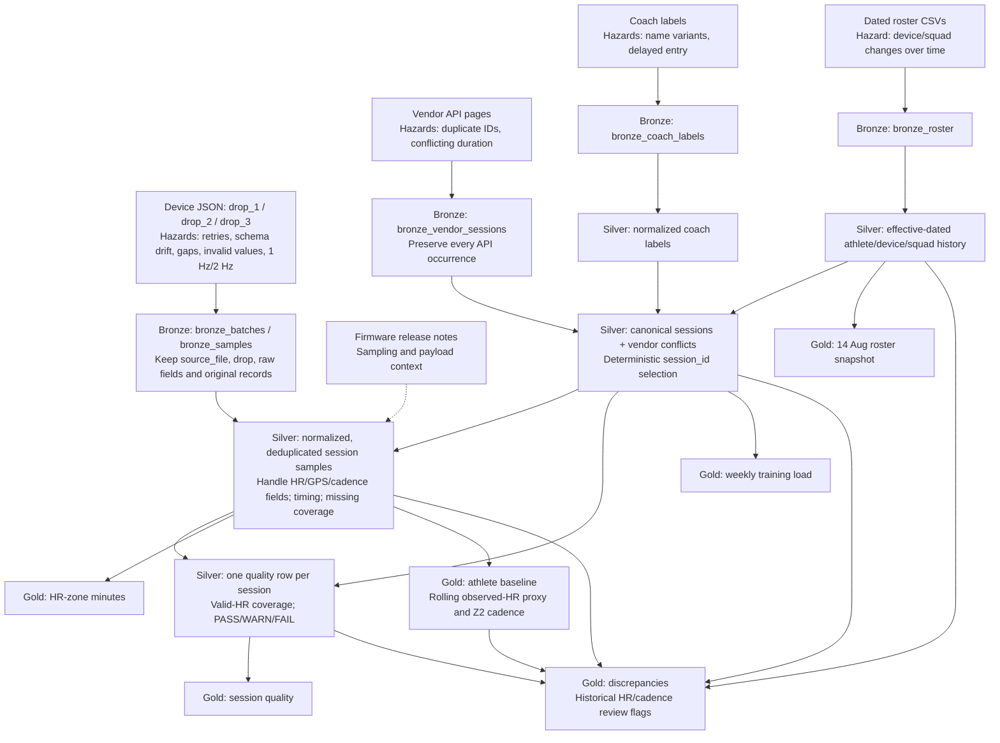

# Stride Performance Lab — Data Engineering Pipeline (PySpark)

A reproducible Bronze → Silver → Gold pipeline for six athletes across the Endurance and Speed squads in Islamabad. The assessment season is **6 July–30 August 2026**. The input contains three device-sync drops, vendor session pages, two roster snapshots, coach labels, and firmware release notes.

**Core principle:** A missing sensor sample means **unobserved time**, not zero heart rate, zero activity, or time in Zone 1.

## How to run

### Prerequisites and layout

- Python and a working PySpark/Java environment.
- Run all commands from the project root (the directory containing `src/` and `data/`).
- Extract `stride_candidate_data.zip` so that `data/device_sync/`, `data/vendor_api/`, `data/roster/`, `data/coach_app/`, and `data/firmware/` exist.
- Activate the project virtual environment and install the dependencies used by the submitted code. The exact Python/Java/Spark versions and installation command should be recorded from the final environment; they have not been independently established here.

```powershell
# End-to-end build
python src/run_pyspark_pipeline.py --drop 3

# Or run the stages separately, in order
python src/bronze/ingest_all.py --drop 3
python src/silver/process_silver.py
python src/gold/mart_athlete_baseline.py
python src/gold/build_marts.py
```

The Bronze outputs are Parquet datasets under `data/bronze_storage/`; Silver outputs are under `data/silver_storage/`. Gold reporting outputs are written to `data/gold_marts/` as Parquet datasets and corresponding `csv_...` export directories.

### Three-drop ingestion

The provided `src/bronze/ingest_all.py` accepts `--drop 1`, `--drop 2`, or `--drop 3`. **Each invocation rebuilds the Bronze device tables from all drops numbered 1 through N, using Parquet `overwrite` mode.** It is a **cumulative rebuild**, not append-only ingestion.

```powershell
python src/bronze/ingest_all.py --drop 1
python src/bronze/ingest_all.py --drop 2
python src/bronze/ingest_all.py --drop 3
```

Previously reported cumulative results:

| Invocation | Drops included | Batch records | Raw sample records |
|---|---|---:|---:|
| `--drop 1` | 1 | 52 | 160,260 |
| `--drop 2` | 1 + 2 | 113 | 396,420 |
| `--drop 3` | 1 + 2 + 3 | 160 | 585,660 |

The reported cumulative totals imply 52, 61, and 47 additional device-batch records in drops 1, 2, and 3 respectively. Each Bronze invocation also rebuilds the vendor, roster, and coach tables. Counts above are cumulative, not the number of *newly appended* records.

**Important verification boundary:** These counts demonstrate the Bronze drop sequence. To prove the assessment's stronger requirement—*correct marts after each drop*—run Silver and Gold after each step, save per-stage results, and compare the final three-drop marts with an independent full build. Do not claim this comparison passed unless the output evidence is retained.

### Idempotency checks

The following sequence passed on the final reported run (six checks, including idempotency):

```powershell
python src/run_pyspark_pipeline.py --drop 3
python src/tests/test_pipeline.py --snapshot
python src/run_pyspark_pipeline.py --drop 3
python src/tests/test_pipeline.py --verify
```

This checks stable business-level Gold outputs across a rerun with unchanged input. It does **not** establish byte-identical Parquet files unless file hashes are also compared.

### Single-day reprocessing demonstration

The reported command and output are:

```powershell
python src/reprocess_day.py --date 2026-08-14
```

Reported results: **6 target-date sessions**, **152 other-date sessions**, **PASS** for staging isolation, with staged output at `data/silver_storage/silver_sessions_reprocessed`. The original Silver tables were reported unchanged.

**Scope of proof:** This establishes isolated **staging**, not that the production Silver and Gold marts were selectively replaced. A complete demonstration must safely commit only the selected date, rebuild affected dependent marts, and show that all other dates' business rows are unchanged. Confirm the actual behavior of `src/reprocess_day.py` before claiming production date-level replacement.

---

## Grain and keys

*Grain* means what one row represents. The keys below are the intended logical uniqueness constraints; the actual column names and uniqueness should be checked against the final output schemas.

| Dataset / mart | One row represents | Intended logical key |
|---|---|---|
| `bronze_batches` | One original device upload batch | Source file / batch identity (raw duplicates retained) |
| `bronze_samples` | One raw sample at its original position in an upload | `source_file`, `sample_index` |
| `bronze_vendor_sessions` | One vendor session occurrence on an API page | `source_file`, `session_index` |
| `bronze_roster` | One athlete row in one dated roster export | `source_file`, `athlete_id` |
| `bronze_coach_labels` | One exported coach-label record | Source record identity; verify columns |
| `silver_sessions` | One canonical vendor session | `session_id` |
| `silver_session_samples` | One selected, session-attributed sensor observation | Session and device/sample timestamp; check tie-breaking |
| `silver_session_quality` | One session's HR-coverage quality | `session_id` |
| `mart_weekly_training_load` | One athlete's weekly training aggregate | `athlete_id`, week start; include squad if the mart splits historical squads |
| `mart_hr_zone_minutes` | One session's observed Z1–Z5 minutes | `session_id` |
| `mart_session_quality` | One session's completeness and quality status | `session_id` |
| `mart_roster_snapshot` | One athlete's membership/device on 2026-08-14 | `athlete_id` for this fixed-date snapshot |
| `mart_discrepancies` | One identified discrepancy or affected record | Depends on discrepancy type; verify source-record key |
| `mart_athlete_baseline` | One athlete's baseline on an observation date | `athlete_id`, observation date; confirm exact output columns |

The main reason to enforce session grain is to avoid multiplying minutes when vendor pages or device uploads repeat records. The discrepancy audit can legitimately contain multiple records for one source ID when multiple occurrences or issues are retained.

---

## What I found

### Sources and observed scale

| Source | Observed / reported count | Treatment |
|---|---:|---|
| Device upload JSON | 160 batch files | Retain original batches and lineage |
| Device sample records | 585,660 raw records | Retain original values and repeated readings in Bronze |
| Vendor API | 206 raw occurrences; 158 unique session IDs | Canonicalize by session ID in Silver |
| Roster snapshots | 11 reported rows across two exports | Apply dated athlete/device/squad history |
| Coach labels | **158** coach-label records (reported by ingestion) | Join to athlete/session using normalized identity and date |

The difference between **206 vendor occurrences and 158 unique IDs is 48 excess occurrences**. Do not describe this as 96 duplicate records without a separately defined count.

### Anomalies: symptom → likely cause → handling and rationale

1. **HR field variations.** Some source samples use `hr`, others `heart_rate`. The supplied Bronze code explicitly declares both fields and uses `coalesce(heart_rate, hr)` for the numeric `hr` column, while retaining `raw_hr` and `raw_heart_rate`. This avoids losing values because of a schema variation. The exact version that introduced the change should be verified against raw records and release notes.
2. **GPS layout variations.** Samples may have top-level `lat`/`lon` or a nested `gps` structure. Bronze retains `raw_lat`, `raw_lon`, and `raw_gps`, and uses nested coordinates first when available. This standardizes location values without discarding the original representation.
3. **Cadence type variation.** Bronze reads cadence as a string and casts it to double for downstream calculations, preserving `raw_cadence`. Invalid casts should be inspected rather than silently treated as valid measurements.
4. **Sampling-frequency changes.** The firmware notes describe a change from nominal 1 Hz to 2 Hz HR sampling. Counting every sample as one second would inflate time in HR zones. Silver uses timestamp gaps and nominal sampling intervals (0.5 s for firmware starting `2.4`, otherwise 1.0 s) to assign defensible covered seconds. Unobserved time is not assigned to a zone. The default interval is an assumption for unknown firmware and deserves further validation.
5. **Repeated and conflicting vendor sessions.** Multiple API pages/retries contain the same session IDs. Bronze deliberately preserves all 206 occurrences. Silver selects one canonical row per `session_id` using deterministic ordering and retains conflict evidence. In previous test results, `Se06bc0e7` resolved to **2,040 seconds** rather than a conflicting **2,400-second** value.
6. **Repeated device readings.** Previously reported Silver results identify **2,340 duplicate sample records**. The Silver selection rule uses device identity, sample timestamp, and deterministic source ordering. Duplicates should remain auditable in a separate rejection/duplicate dataset rather than being removed from Bronze.
7. **Time-dependent athlete/device ownership.** The July and September roster exports do not by themselves give an exact change date for every reassignment. Silver uses an effective-dated mapping, including reported August changes. These effective dates are assumptions unless corroborated by source evidence; document them explicitly.
8. **Coach-label inconsistencies.** Coach notes can contain athlete-name variants or be entered after the session. Use normalized identity and the workout's date for attribution; retain the original label and entry timestamp for audit.
9. **Missing/invalid sensor readings.** Invalid HR, cadence, and GPS readings are flagged or excluded from calculations as appropriate. A missing or invalid HR reading is **not** interpreted as zero HR. Earlier Silver analysis reported **32 of 158 sessions** with nonzero missing valid-HR coverage, **74,941 seconds** of missing valid-HR coverage, and **240 seconds** of internal sample gaps. Missing valid-HR coverage includes invalid readings as well as unobserved intervals; it is not equivalent to a count of physically absent samples.

### Baseline-driven discrepancy checks (Part 2)

The runner now executes `mart_athlete_baseline.py` **before** `build_marts.py`. The Gold discrepancy builder reads `mart_athlete_baseline` and checks two additional conditions against **prior-day** reference values:

- **Unusual running cadence:** Daily median of valid Zone 2 running cadence differs by **more than 20%** from the latest available earlier rolling 28-day cadence baseline, with at least 30 reference readings and 10 current-day readings.
- **Elevated minimum observed HR:** The day's minimum valid observed HR exceeds the latest available earlier 7-day minimum-observed-HR reference by **more than 25 bpm**.

These thresholds are investigative heuristics, not validated clinical or sensor-failure thresholds. The reference uses the latest eligible prior rolling baseline, not a freshly recalculated window for each comparison. The baseline's minimum observed HR is **not** a direct resting-HR measurement. Do not overwrite raw samples based on these flags.

The final reported discrepancy mart contains **2,466 rows**. The log does not break out counts by anomaly category; the total alone does not prove either baseline rule flagged a record. The code integrates the rules, but their category counts should be queried before claiming positive baseline findings.

### Device-sync data contract (Part 2)

A proposed upstream contract for each JSON upload batch:

| Contract rule | Expected behavior | Hazard addressed |
|---|---|---|
| Required batch metadata | Nonempty `batch_id`, `device_id`, `firmware`, `app_version`, `uploaded_at` | Untraceable or malformed uploads |
| Stable batch identity and replay semantics | Retries reuse a stable upload identity or carry an explicit idempotency key | Duplicate uploads |
| Explicit schema version | Declare supported HR/GPS field names and payload structure | Unexpected `hr`/`heart_rate` and nested GPS changes |
| Sample time and frequency | Every sample has a parseable timestamp; batch declares sampling rate or clock semantics | Incorrect 1 Hz vs 2 Hz duration calculations |
| Sample-count integrity | `sample_count` must equal the number of `samples` entries | Truncated/inconsistent batches |
| Value and coordinate validation | Numeric HR/cadence when present; valid latitude/longitude ranges; null permitted with reason | Malformed sensor values |
| Sample ordering and identity | Define whether equal `(device_id, timestamp)` values are retries or distinct sensor events | Duplicate sample ambiguity |

**At least two preventable hazards:** inconsistent schema changes without a declared version and duplicate retries without an idempotency key. A contract can reject or quarantine malformed payloads; it **cannot** restore readings never recorded due to lost sensor contact, guarantee that a plausible HR value is physiologically accurate, or establish the true athlete/device owner without an authoritative assignment history.

### Source-to-mart flow map (hazards marked)



The diagram shows **where** hazards originate and **where** they are handled. It does not imply that Bronze deletes duplicates: the supplied Bronze code uses overwrite to rebuild tables, but preserves repeated source rows within each build.

---

## Reconciliation

Control week: **Monday 10 August through Sunday 16 August 2026**, in athlete-local time.

| Athlete | Portal expected sessions | Final tested result | Difference |
|---|---:|---:|---:|
| Ali Raza | 4 | 4 | 0 |
| Sara Khan | 5 | 5 | 0 |
| Hamza Tariq | 4 | 4 | 0 |
| Zainab Mirza | 4 | 4 | 0 |
| Bilal Ahmed | 4 | 4 | 0 |
| Mehak Noor | 2 | 2 | 0 |
| **Total** | **23** | **23** | **0** |

| Endurance logged minutes | Minutes |
|---|---:|
| Vendor portal control | 689.0 |
| Final pipeline result | 689.0 |
| **Residual** | **0.0** |

The logged Endurance minutes reconcile exactly. The control is based on vendor-logged session durations, not on the sum of observed HR-zone minutes.

Reconciliation concerns **vendor-logged training duration**, not the sum of valid observed HR-zone time. Missing HR coverage can make the latter smaller without making the logged-duration reconciliation wrong.

---

## Definitions

- **Session:** One canonical vendor-defined training activity, identified by `session_id`, with a device, start/end timestamps, and a selected duration.
- **Week:** Monday–Sunday using the athlete's local time. For this Islamabad programme, use **Asia/Karachi (UTC+05:00)** consistently; verify the Spark session timezone and conversion logic.
- **Training load:** In this implementation, an operational weekly volume measure such as distinct sessions, total vendor-logged minutes, and distance. It is **not** a validated physiological training-stress score.
- **HR zones:** Based on the roster `max_hr` applicable to the session: Z1 <60%; Z2 60–<70%; Z3 70–<80%; Z4 80–<90%; Z5 ≥90%. Each valid observation contributes only its defensible covered duration.
- **Completeness:** `100 × valid_hr_seconds / vendor_duration_seconds`, capped at 100% for valid positive durations. `valid_hr_seconds` represents time covered by accepted HR observations, not simply the number of sample rows.
- **Quality flags:** **PASS ≥80%**, **WARN ≥60% and <80%**, **FAIL <60%**. These are project-defined operational screening thresholds, not clinical cutoffs. Sessions below 80% should be clearly surfaced for review.
- **Missing valid-HR seconds:** Session duration minus accepted HR coverage (not below zero); includes unobserved time and time with invalid HR values.
- **Internal gap seconds:** Gaps identified between consecutive observed samples beyond the expected sampling interval. This differs from total missing valid-HR coverage.
- **Baseline:** A rolling **7-day minimum observed HR proxy** and **28-day median Zone 2 running cadence** in the implemented baseline. The low observed HR proxy is **not a clinically measured resting HR**. Baseline deviations are prompts to investigate data quality or training context, not diagnoses.

---

## Tests

The final reported execution passed **all six tests**, including the unchanged-input rerun comparison. Rerun them after any code change.

| Test | What it protects against | Previously reported result |
|---|---|---|
| Unique canonical session IDs | Double-counted vendor sessions | No duplicate `session_id` in HR-zone mart |
| One quality row per session | Missing or multiplied session quality | 158 session-quality rows for 158 sessions |
| Deterministic vendor conflict selection | Unstable duration selection across retries | `Se06bc0e7` selected as 2,040 s |
| HR-zone duration conservation | Double-counting 1 Hz/2 Hz readings or gaps | No sessions exceeding tested duration tolerance |
| Control-week reconciliation | Incorrect athlete/squad attribution or training totals | 23 expected/observed sessions; 689.0 Endurance minutes |
| Gold idempotency | Different business results from unchanged input | Reported identical logical outputs on rerun |

For a repeatable rerun check:

```powershell
python src/run_pyspark_pipeline.py --drop 3
python src/tests/test_pipeline.py --snapshot
python src/run_pyspark_pipeline.py --drop 3
python src/tests/test_pipeline.py --verify
```

**Drop-order evidence:** Bronze cumulative counts were reported as 52/160,260 → 113/396,420 → 160/585,660. Gold correctness **at each intermediate stage** requires separate retained output comparisons. The runner accepts `--drop 1`, `--drop 2`, and `--drop 3`, but the supplied sequential-drop evidence is Bronze-level.

**Date-reprocessing evidence:** The reported 2026-08-14 staging test returned 6 target-date sessions and 152 other-date sessions, with an isolation PASS. The original Silver tables remained unchanged. This does **not** yet prove selective production mart replacement.

**Evidence:** The full-run and verification logs reported `ALL PIPELINE STAGES COMPLETED SUCCESSFULLY` and `PASS 6: All marts identical after pipeline rerun`. The Bronze drop counts and date-isolation result were also supplied as execution evidence. Gold correctness at intermediate drops and production selective replacement were not separately demonstrated.

---
## AI usage

AI assistance (ChatGPT) was used to explain the assessment, discuss PySpark architecture, review code and test plans, and help draft documentation. Every technical claim must be checked against the submitted scripts, source records, and actual run outputs.

**AI suggestion checked and corrected:** An earlier proposed implementation treated a staging-only single-day rebuild as if it proved production-level selective reprocessing. Reviewing `src/reprocess_day.py` showed it writes `silver_sessions_reprocessed` and explicitly leaves the original Silver table unchanged. I corrected the documentation to describe this as a **staging and isolation demonstration**, not a committed production update. This is a concrete example of checking AI guidance against code and observed output.

AI-generated assumptions about firmware changes, root causes, dates, and exact numerical counts must be treated as hypotheses until checked against raw data or pipeline logs. The baseline anomaly thresholds were proposed during code review and should not be represented as vendor-specified limits.
---
## What I would do with another day

1. **Complete and prove selective date replacement:** Safely stage, validate, and commit a single date in Silver and affected Gold marts; compare hashes or logical row snapshots for every other date.
2. **Prove final-mart equivalence after sequential drops:** Save Gold snapshots after drops 1, 2, and 3 and compare the final output with a clean full three-drop build.
3. **Automate device-sync contract checks:** Validate schema version, batch identity, sample timestamps, numeric fields, and declared sample count at ingestion; quarantine invalid batches with clear error reports.
4. **Improve effective-date evidence:** Replace manually assumed athlete/device transfer dates with authoritative assignment events.
5. **Add operational observability:** Monitor ingestion volume, duplicate rates, HR coverage, firmware mix, and unresolved conflicts.
6. **Consider transactional storage:** Evaluate Delta Lake or equivalent atomic partition replacement to make selective reprocessing safer.

---

**Submission note:** The assessment also requests pipeline code, a `session_quality` table with one row per session, and a source-to-mart flow map. The flow map is included above; deliver the generated quality dataset and runnable scripts alongside this README.
